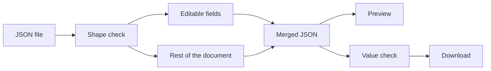

# Configuration Editor

A browser editor for a release-configuration file. The user opens a JSON file, updates the release details, checks them, and downloads the result.

The details are split into four steps: Access Configuration Manager, Branch Selection, Build, and Copy to Target Directory. An optional version description can hold a version, a release date, and recent fixes. The app edits and saves those details. It does not connect to a server, run a build, or copy files.

React, TypeScript, MUI, React Hook Form, Zod, and Vite.

## Key features

- **Guided editing.** Each release step has its own screen, and values stay in place while moving between steps.
- **Open a JSON file.** The file is checked before it replaces the current configuration. Invalid JSON or an unexpected structure is reported, and the editor stays as it is.
- **Clear validation.** A field explains the problem after the user leaves it. Download stays disabled until the configuration is valid. On the last step, the message names where to fix each problem.
- **Optional version description.** The user can add a version, a release date, and recent fixes, or remove that block.
- **JSON preview.** The file that would be downloaded can be shown first. Because the preview includes the password in plain text, it stays hidden until the user confirms.
- **Extra JSON fields.** Keys that have no field on the screen are kept and written back, including nested keys.
- **Unsaved changes.** Leaving the page can warn the user. Opening another file asks before it replaces an edit that has not been downloaded.
- **Download.** The updated configuration is downloaded as JSON. The file name is the opened name, or `release-config.json` for a new draft.

## Architecture and design decisions

The screen is a small set of step forms, a version-description section, and a preview. The original document is preserved separately from the editable form fields, allowing additional JSON properties to remain intact. Opening a file checks its shape, then copies the known fields into the form. Download merges those fields back into the document and checks the values.



**A file can be opened before every value is valid.** The assignment does not define formats. The shape check only asks whether the expected sections are present, so a draft with empty fields can be corrected. A separate value check blocks download until the fields are filled and usable: an `http` or `https` URL, a real date, and a directory path. The downloaded file is still the merged document, so the value check does not rewrite the other keys.

**The form does not own the whole file.** Unknown keys never enter the form. They stay on the stored document and are copied through to the download. Removing the version description is an explicit action, so editing another field does not drop that block.

**Saving downloads a new file.** A page cannot write the path selected in the file picker. The assignment asks for the configuration to be saved, so the editor downloads a new JSON file instead of changing the original one. An edit that has not been downloaded is not replaced by another file without confirmation.

## Getting started

```bash
npm install
npm run dev
```

Open [http://localhost:5173](http://localhost:5173). The sample file is `release-config.example.json`.

```bash
npm run lint
npm test
npm run test:e2e
npm run build
```

`npm test` runs the unit tests. `npm run test:e2e` runs the browser tests in Chromium and starts the app at [http://127.0.0.1:5175](http://127.0.0.1:5175). Install that browser once with `npx playwright install chromium`. `npm run build` typechecks the project and creates the production build.

## Scope and limitations

This editor runs in the browser and does not perform the release. Saving downloads a new JSON file, and a refresh discards edits that were not downloaded.
